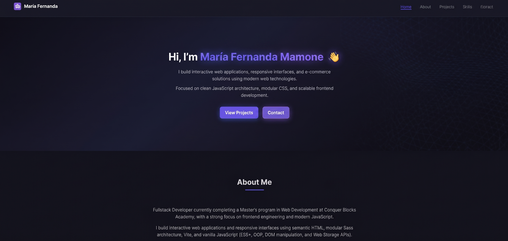

# Personal Developer Portfolio

My personal web development portfolio showcasing real-world e-commerce projects, interactive vanilla JavaScript applications, and modular frontend architectures.

👆 **Click the preview image above to visit the Live Portfolio!**

## Features

- **Responsive Single-Page Architecture:** Smooth navigation across Hero, About Me, Featured Projects, Technical Skills, and Contact sections with a mobile hamburger menu.
- **Interactive Certificates Modal:** Displays verified Master's program certificates from Conquer Blocks Academy.
- **Curated Project Showcase:** Highlights production e-commerce work (WordPress/WooCommerce), Object-Oriented JavaScript applications, and modular Sass websites.
- **One-Click Email Copy:** Direct `mailto:` integration paired with Clipboard API copy feedback for effortless contact.
- **Automated Deployment:** Built with Vite and deployed automatically to GitHub Pages via GitHub Actions.

## Tech Stack

- **HTML5:** Semantic structure and accessible markup
- **Sass (SCSS):** Modular 7-1 inspired architecture (`abstracts`, `base`, `components`, `layout`, `themes`)
- **JavaScript (ES6+):** Mobile menu toggle, certificate modal logic, and Clipboard API
- **Vite & GitHub Actions:** Fast bundling and continuous deployment to GitHub Pages

## Getting Started

1. Clone the repository:
   git clone https://github.com/mariafernandamamone/Fernanda-Mamone-Portfolio.git

2. Install dependencies:
   npm install

3. Run the development server:
   npm run dev

## Author

Developed with 💜 by **María Fernanda Mamone**

- **Live Portfolio:** https://mariafernandamamone.github.io/Fernanda-Mamone-Portfolio/
- **LinkedIn:** https://www.linkedin.com/in/mfmamone/
- **GitHub:** https://github.com/mariafernandamamone
- **Email:** [mariafrenchitas@gmail.com](mailto:mariafrenchitas@gmail.com)